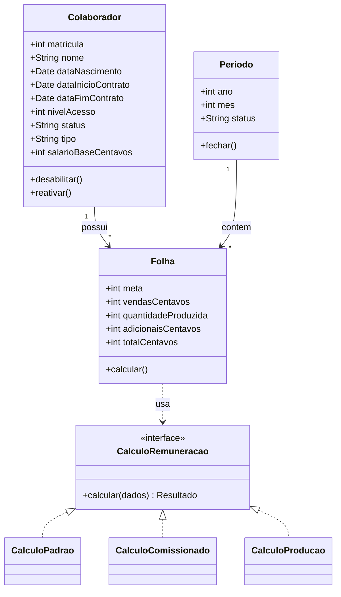
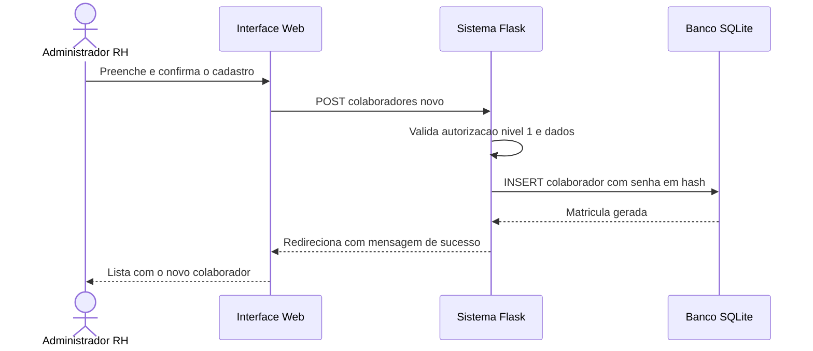
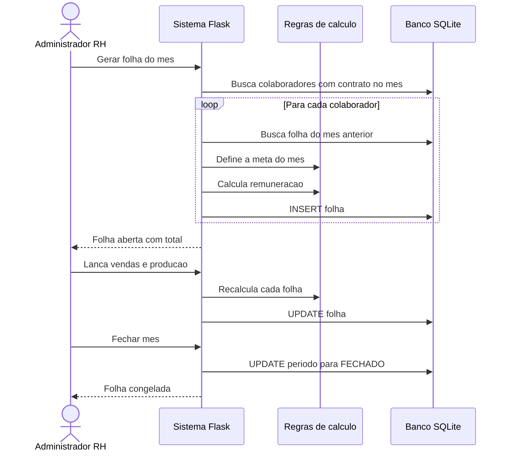
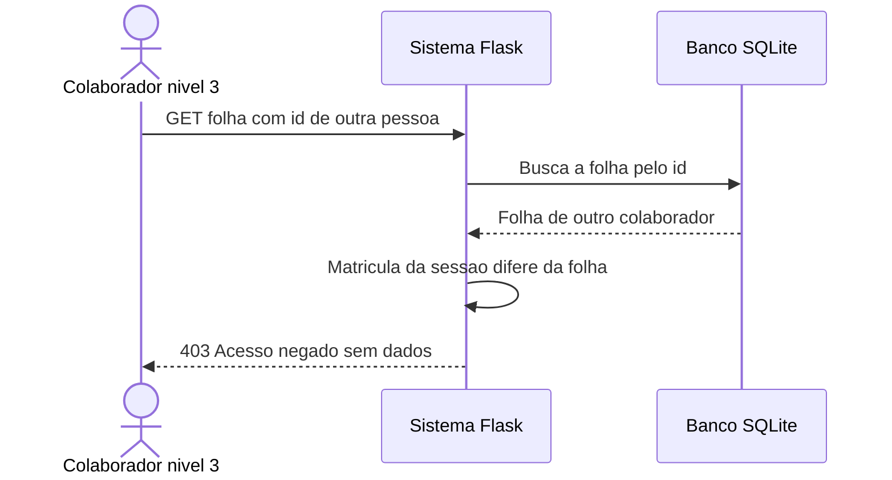
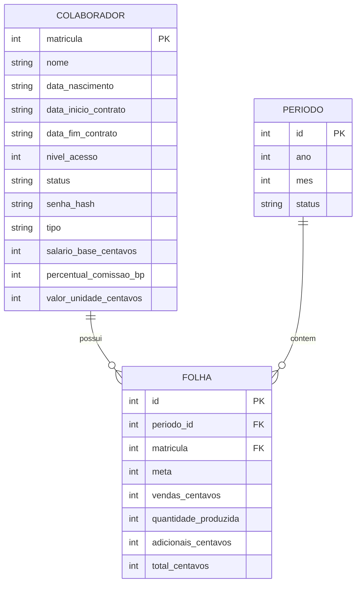
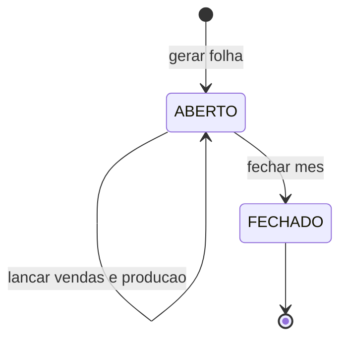

# 4. Diagramas UML

## Diagrama de Classes (modelo de domínio)
As estratégias de cálculo são implementadas como funções registradas em `CALCULADORES` (módulo `regras.py`);
no diagrama aparecem como classes para representar o padrão **Strategy** (RNF004).

## Diagrama de Sequência – Cadastro de colaborador

## Diagrama de Sequência – Geração, lançamento e fechamento da folha

## Diagrama de Sequência – Acesso negado ao nível 3

## Modelo de Dados (ER)

## Diagrama de Estados – Período da folha

